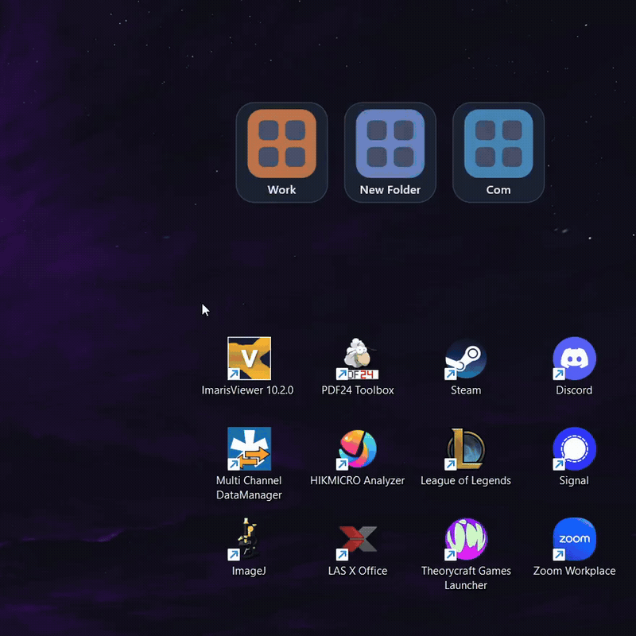

# NestDesktop

A crowded desktop is hard to keep organised. NestDesktop allows you to
group apps and shortcuts into compact, expandable folders directly on the Windows desktop.

<!-- nestdesktop-demo:start -->

[Full-quality video (MP4)](docs/media/demo.mp4)

<!-- nestdesktop-demo:end -->

- Preview apps inside coloured groups, with nested folders for another layer.
- Drag shortcuts into, out of and between groups; arrange them in your own order.
- Open groups by click or hover, pin them open, and choose preset or custom colours (by clicking the folder icon).
- Keep the normal Windows desktop and app right-click menus.

## Install

Download the **Windows x64 ZIP** from this repository's **Releases** section,
extract it, and open **NestDesktop-Setup.exe**. No additional tools are needed.
Right-click the desktop and choose **New app folder** to get started
(under **Show more options** on Windows 11).

## Lightweight

Measured with **5 desktop groups and 53 collected shortcuts**, including the
app and its recovery helper:

| Resource | Measured idle usage |
|---|---|
| CPU (5 min) | **0.000 CPU seconds** |
| App executable | **1.0 MiB** |
| Memory | **46.8–52.1 MiB** |

Measured on Windows 11 with folders and settings closed. No CPU time was
measurable during the test. Memory is the combined working set, including
shared Windows libraries. Usage varies with contents and interaction.
[Measurement details and raw results](docs/performance.md).

## Status

Only selected desktop shortcuts are collected; installed apps and documents
are not physically moved. Collected shortcuts return when NestDesktop quits,
with recovery for unexpected exits. Saved layouts are kept when uninstalling
and can also be exported.

[Usage guide](docs/usage.md) · [Build from source](docs/building.md) ·
[Testing and limitations](docs/testing.md)

## Support

If NestDesktop is useful to you, I'd be happy if you could support the development
of my further projects on [Ko-fi](https://ko-fi.com/leowerner).

Unfortunately, I won't be able to actively support NestDesktop beyond my own
needs, but please feel free to clone the repository and adjust it to your needs.
I released it under the MIT open-source licence.

## Licence

[MIT](LICENSE). Dependency licences and attributions are listed in
[Third-party notices](THIRD_PARTY_NOTICES.md).
